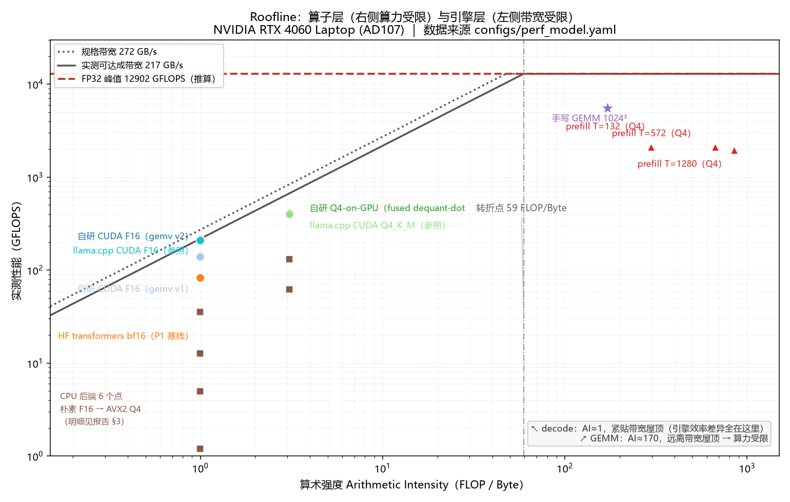

# P11 · Roofline 性能模型（算子层 ↔ 引擎层的桥）

> 生成：p11_perf_20261010_031115 ｜ 屋顶线带宽：**217.4 GB/s（实测）** ｜ FP32 峰值：**12.902 TFLOPS（时钟 2.1 GHz，推算）**
> 参数唯一来源：`configs/perf_model.yaml`（本报告全部数字可由它复算）

## 0. 结论（三句话）

1. **decode 是带宽受限，不是算力受限**：算术强度 **AI = 1.000 FLOP/Byte**，而屋顶线转折点在 **59.3 FLOP/Byte** —— 差 59 倍，所以优化方向只能是「少读字节」，不是「多堆算力」。
2. **引擎层的差距是「利用率」，不是「物理极限」**：自研 CUDA F16 实测 **62.5 tok/s = 带宽屋顶的 99.3%**；而 P1 的 HF bf16 只有 38.1% —— 换引擎的 ×5.2~6.6 就藏在这个差额里。
3. **Q4 没到带宽屋顶，是另一类瓶颈**：Q4-on-GPU 实测 **119.4 tok/s = 屋顶的 61.5%**，反推等效带宽 **134 GB/s** < 实测天花板 217.4 GB/s → 卡在 fp32 精确 dequant 的**指令发射**上（与 `docs/28` §6.3 / `docs/29` §7.3 独立吻合）。



> 图：`reports/p11_roofline.png`（双对数 Roofline，两条屋顶线 + 全部实测点）。

## 1. 模型自检（先把「模型本身对不对」钉死）

| 检查项 | 结果 |
|---|---|
| 参数量（架构参数独立复算） | **1,720,451,072**（= docs/20 的 1.72B）|
| 每层参数量 | 50,331,648 |
| 层参数 / 词表嵌入 | 1,409,286,144 / 311,164,928 |
| 张量数 | 310（= 28×11+2，与 GGUF header 吻合）|
| KV cache | 229,376 B/token（224 KiB，**F32**）|
| 断言 | 13/13 通过（critical 失败 0，warning 失败 0）|

## 2. decode 恒定的两个量（与后端无关）

| 精度 | 权重字节 | AI (FLOP/Byte) | 理想耗时（带宽屋顶） | 理论 tok/s |
|---|---|---|---|---|
| F16 | 3.454 GB | **0.996** | 15.886 ms | 63.0 |
| Q4_K_M | 1.120 GB | **3.073** | 5.152 ms | 194.1 |

（ctx = 55 token 是按实测协议取的；权重读一遍 + KV 读一遍，二者都算进去了）

### 2.1 KV 长度敏感性（结论不依赖 ctx 取值）

| ctx | KV 读取 | 每 token 总访存 | Q4 屋顶预测 tok/s | Q4-on-GPU 利用率 |
|---|---|---|---|---|
| 55 ←本模型默认 | 12.6 MB | 1.120 GB | 194.1 | 61.5% |
| 105 | 24.1 MB | 1.131 GB | 192.1 | 62.1% |
| 300 | 68.8 MB | 1.176 GB | 184.8 | 64.6% |

> `docs/28` §2.2 的屋顶线账用的是 pos≈300（更保守）。本表说明：ctx 从 55 变到 300，Q4 的利用率只从 ~62% 动到 ~65%，**「Q4 远低于带宽屋顶」这个结论不变**。

## 3. ⭐ 与实测对比：把「快多少」翻译成「离屋顶多远」

| 实测点 | 层 | tok/s（实测） | 预测（屋顶） | **利用率** | 反推等效带宽 | session |
|---|---|---|---|---|---|---|
| 自研 CUDA F16（gemv v1） | engine | 40.4 | 63.0 | **64.2%** | 139.5 GB/s | B6b（2026-10-07） |
| 自研 CUDA F16（gemv v2） | engine | 62.5 | 63.0 | **99.3%** | 215.8 GB/s | B6b（2026-10-07） |
| llama.cpp CUDA F16（参照） | engine | 60.8 | 63.0 | **96.6%** | 210.0 GB/s | B6b（2026-10-07） |
| 自研 Q4-on-GPU（fused dequant-dot + CUDA Graphs） | engine | 119.4 | 194.1 | **61.5%** | 133.7 GB/s | B7（2026-10-07） |
| llama.cpp CUDA Q4_K_M（参照） | engine | 116.9 | 194.1 | **60.2%** | 130.9 GB/s | B7（2026-10-07） |
| 朴素单线程 F16（CPU） | engine | 0.35 | —（无实测带宽） | — | 1.2 GB/s | B4（2026-10-06） |
| OpenBLAS F32（CPU，对照） | engine | 1.45 | —（无实测带宽） | — | 5.0 GB/s | B5（2026-10-07） |
| OpenMP F16（CPU，16 线程） | engine | 3.67 | —（无实测带宽） | — | 12.7 GB/s | B5（2026-10-07） |
| AVX2 F16（CPU） | engine | 10.3 | —（无实测带宽） | — | 35.6 GB/s | B6a（2026-10-07） |
| AVX2 Q4_K_M（CPU） | engine | 17.9 | —（无实测带宽） | — | 20.0 GB/s | B6a（2026-10-07） |
| llama.cpp CPU Q4_K_M（参照） | engine | 37.9 | —（无实测带宽） | — | 42.4 GB/s | 阶段 A（A3） |
| HF transformers bf16（P1 基线） ⚠️跨session | engine | 24.0 | 63.0 | **38.1%** | 82.9 GB/s | P1 E1（2026-09-14） |

> 「反推等效带宽」= 每 token 访存字节 × 实测 tok/s；与实测天花板 **217.4 GB/s** 比，就是该实现「读带宽的效率」。

### 3.1 同 session 对打（唯一能做紧比较的口径）

> ⚠️ 本项目实测**跨 session 漂移 17.3% ≫ 组内 0.6–3.6%**（`docs/03` 已知局限 6）。
> 因此只有 `paired_with` 声明的点才能比较利用率，其余只作数量级参考。

| 对照 | 自研利用率 | 参照利用率 | 差 |
|---|---|---|---|
| 自研 CUDA F16（gemv v2） ↔ llama.cpp CUDA F16（参照） | 99.3% | 96.6% | **+2.7 pp** |
| 自研 Q4-on-GPU（fused dequant-dot + CUDA Graphs） ↔ llama.cpp CUDA Q4_K_M（参照） | 61.5% | 60.2% | **+1.3 pp** |

## 4. prefill：什么时候从「访存受限」翻到「算力受限」

- decode 的 AI ≈ **1.000 FLOP/Byte**；prefill 的权重只读一遍、FLOPs 随 T 线性涨，故 **AI_prefill(T) ≈ AI_decode × T**。
- 令其等于转折点 59.3 → **T\* ≈ 59 token**。
  → **prompt 超过约 59 个 token，prefill 就从带宽受限转入算力受限**。这就是「PD 分离 / Chunked Prefill 为什么存在」的定量版本。

| prompt T | 实测 tok/s | 算力屋顶 tok/s | 利用率 | 实测 GFLOPS | 算力峰值 GFLOPS | 受限侧 |
|---|---|---|---|---|---|---|
| 132 | 612.0 | 3749 | **16.3%** | 2106 | 12902 | compute |
| 572 | 616.0 | 3747 | **16.4%** | 2121 | 12902 | compute |
| 1280 | 568.0 | 3744 | **15.2%** | 1957 | 12902 | compute |

> ⚠️ 三个点都是 **Q4_K_M**（`docs/29` §4 显存预算表标明 B8 用 Q4_K_M）。实测仅为算力屋顶的 ~16%，与 decode 端 Q4 的 ~62% 同源：**fp32 精确 dequant 抢占了发射槽**。

## 5. 算子层（算力受限侧）：手写 GEMM 的账

- 规模 1024³：FLOPs = **2.15 GFLOP**，理想耗时 0.166 ms
- 峰值（2.1 GHz，**推算**）= **12.902 TFLOPS**
- 实测 **5542 GFLOPS** = 峰值的 **43.0%**
- ⭐ **wave quantization**：8² = 64 个 tile / 24 SM = **3 波** → tile 级上限 **88.9%**（11.469 TFLOPS）
  → 实测达到该上限的 **48.3%**。

> **面试三个必答问题（`docs/16` §4.2）**：① 占峰值多少 → 见上；② **wave quantization** → 3 波尾浪费，tile 级天花板 88.9%，所以 1024³ 本来测不出真峰值；③ 为什么不用 tensor core → FP32 路线不通 tensor core，换 FP16/TF32 才有，而那会改变数值口径。

## 6. 本模型的已知简化（别高估它的精度）

- 只算 matmul + attention 的 FLOPs，忽略 RMSNorm / RoPE / SiLU / softmax / 采样（合计 <1%）
- 激活访存只按『每层 hidden + FFN 中间量各往返一次』估计 —— 真实融合 kernel 会更少
- 不含 kernel launch 开销；B7 用 CUDA Graphs 把它压到可忽略，v1/CPU 路径不含此优化
- Q4 的 dequant 指令开销**不在模型内**：模型给的是带宽屋顶，Q4 落在屋顶下方正是该开销的证据
- CPU 侧不给带宽（未实测）→ CPU 点只报反推带宽，不做预测
- 时钟 2.10 GHz 是推算 → 算力屋顶的绝对值有不确定性；但 decode 结论（带宽受限）对这个值不敏感
- HF bf16 那一行是跨 session / 跨协议的参照（max_new_tokens 974 vs 100，且 HF 同时驻留视觉塔权重）； 本模型只按文本解码器算它的每 token 访存 ⇒ 该行利用率只作数量级参考（报告里已标 ⚠️跨session）

## 7. 怎么复现

```bash
python scripts/p11_perf_model.py --dry-run     # 只算，秒级
python scripts/p11_perf_model.py               # 落报告 + 图
python scripts/p11_perf_model.py --bw spec     # 换成规格带宽当屋顶线
```